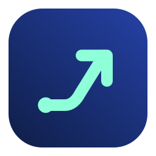

<p align="center"></p>

<h1 align="center">Antigravity Clash Launcher</h1>

<p align="center"><strong>Open Antigravity on macOS through your local proxy. No TUN required.</strong></p>
<p align="center">English · <a href="README.zh-CN.md">简体中文</a></p>

This launcher opens the **Antigravity desktop app** with proxy settings for its window and background process. It works with Clash Verge Rev or another client that exposes a local HTTP or mixed port. It does not change the macOS system proxy, modify the Antigravity app, or bundle a proxy service.

## Build once, then click to launch

You need **macOS 14 or later**, [Antigravity Desktop](https://antigravity.google/download) in Applications (or `~/Applications`), and the Xcode Command Line Tools. If the tools are missing, run `xcode-select --install` first.

```sh
git clone https://github.com/7innng/antigravity-clash-launcher.git
cd antigravity-clash-launcher
./scripts/build.sh
open -R dist/Antigravity-Clash.app
```

1. Start your proxy client. The launcher defaults to **`127.0.0.1:7897`**. If the port is not listening, it asks you for the correct HTTP or mixed port and saves your choice.
2. If Antigravity is already open, quit it with **⌘Q**. Double-click **Antigravity-Clash.app** in Finder, or drag it into the Dock and click it there. Leave your proxy client running.
3. Send a short message in Antigravity to check that it can get a model reply. With Clash in Rule mode, your existing rules still choose the outgoing node.

If you move the launcher to Applications, pin **that copy** to the Dock. Clicking the original Antigravity icon to start a new session does not apply the launcher's proxy settings.

## Change ports or troubleshoot

- **Change the port:** Hold **Option (⌥)** as you open the launcher, or run `open dist/Antigravity-Clash.app --args --configure` from this repository. If Antigravity is already running, the new port takes effect after you quit and relaunch it.
- **The window opens, but there is no reply:** Check whether Antigravity's API connections appear in your proxy client. The launcher checks the local port and supplies proxy settings; it cannot override a component that ignores them, Google account eligibility, or the proxy's routing rules.
- **Installing from a Release:** Releases contain source code. The build script creates a locally signed app; this project does not ship a Developer ID–signed and notarized download.

[MIT License](LICENSE). Independent project; not affiliated with Google or Clash Verge Rev.
