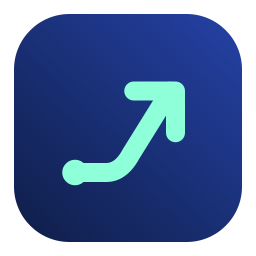

<p align="center"></p>

<h1 align="center">Antigravity Clash 启动器</h1>

<p align="center"><strong>让 macOS 上的 Antigravity 走本地代理，不用开 TUN。</strong></p>
<p align="center"><a href="README.md">English</a> · 简体中文</p>

启动器给 **Antigravity 桌面版**的界面和后台进程传入代理设置。可配合 Clash Verge Rev，或其他提供本地 HTTP 端口、混合端口的客户端使用。不修改 macOS 系统代理或 Antigravity 原程序，也不提供代理服务。

## 构建一次，以后点击启动

需要 **macOS 14 或更新版本**、放在「应用程序」或 `~/Applications` 的 [Antigravity 桌面版](https://antigravity.google/download)，以及 Xcode 命令行工具。如果未安装工具，先运行 `xcode-select --install`。

```sh
git clone https://github.com/7innng/antigravity-clash-launcher.git
cd antigravity-clash-launcher
./scripts/build.sh
open -R dist/Antigravity-Clash.app
```

1. 打开代理客户端。启动器默认连接 **`127.0.0.1:7897`**。如果端口没有监听，启动器会提示填写正确的 HTTP 端口或混合端口，并记住选择。
2. 如果 Antigravity 已打开，先按 **⌘Q** 退出。然后在访达双击 **Antigravity-Clash.app**，也可把它拖到 Dock，以后点击启动。使用时保持代理客户端运行。
3. 给 Antigravity 发一句测试消息，确认能收到模型回复。如果 Clash 使用规则模式，仍由你自己的规则选择出站节点。

如果要把启动器放进「应用程序」，移动后再拖到 Dock。直接点原版 Antigravity 图标冷启动，不会带上启动器设置的代理。

## 换端口与排查

- **换端口：** 按住 **Option（⌥）** 打开启动器，或在仓库目录运行 `open dist/Antigravity-Clash.app --args --configure`。如果 Antigravity 正在运行，新端口会在退出并重新启动后生效。
- **窗口打开了，模型没回复：** 在代理客户端的连接列表里检查是否收到 Antigravity 的 API 请求。启动器只检查本地端口是否监听，并传入代理设置；应用组件是否遵循代理、Google 账号资格和出站规则另行决定。
- **关于 Release：** 发布页提供源码。构建脚本会在本机生成并签名 App；本项目未提供经 Developer ID 签名及 Apple 公证的下载版。

采用 [MIT 许可证](LICENSE)。本项目为独立项目，与 Google 或 Clash Verge Rev 无隶属关系。
